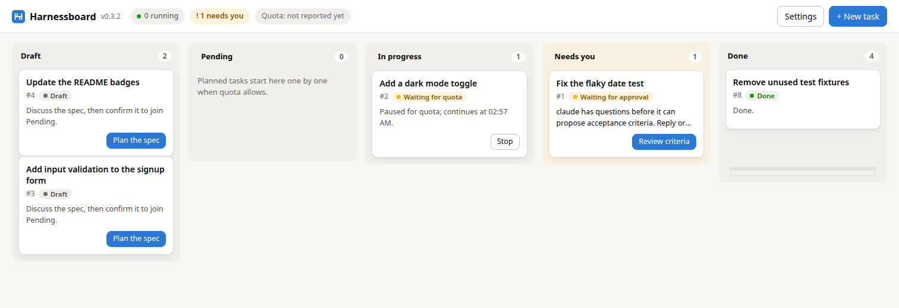
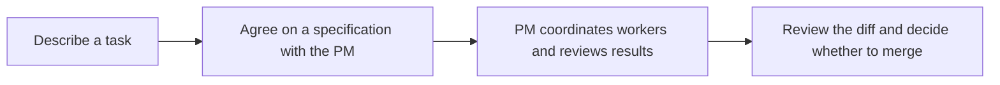

# Harnessboard

Harnessboard coordinates AI coding agents on a local task board so you can review their work before merging it.

  

**English** · [繁體中文](README.zh-TW.md)





- **One PM** coordinates work, permissions and review; independent workers can use separate branches.
- **Local board** shows progress, questions, usage and results. Your review controls the merge.
- **Agents:** Claude Code and Codex can act as PMs; Gemini and Docker profiles can work on tasks. See [configuration](docs/configuration.md) and [PM workflow](docs/pm-workflow.md).

## Quick start

Allow about three minutes to get started, plus dependency download and build time. You need **Git**, **Node.js 22.13+**, Corepack, and a supported agent CLI such as [Claude Code](https://docs.claude.com/en/docs/claude-code), installed and signed in.

**1. Install and build** in a Bash-compatible terminal:

```bash
git clone https://github.com/AquilaWei/harnessboard.git
cd harnessboard
corepack enable
pnpm install --frozen-lockfile
pnpm build
alias hb="node $PWD/packages/server/dist/cli.js"
```

**2. Start the board** and leave it running:

```bash
hb serve &
```

Open [http://127.0.0.1:4317](http://127.0.0.1:4317). Keep using the same terminal for the following commands.

**3. Create a first task** in a disposable Git repository (Git must have a configured author):

```bash
mkdir hello && cd hello
git init -b main
echo "# Hello" > README.md
git add README.md && git commit -m "init"
hb add "Add a Usage section to README.md" --criteria "- README.md has a Usage section"
hb ls
```

Open the task on the board to follow the PM conversation and approve its specification. When it is done, use `hb diff <id>` to review and `hb merge <id>` to merge. See [CLI reference](docs/cli.md) and [workflow](docs/workflow.md) for details.

## Learn more

- [Configuration, agents and permissions](docs/configuration.md) · [PM workflow](docs/pm-workflow.md) · [Web board](docs/web-board.md)
- [Desktop app](docs/desktop-app.md) · [Phone and Android access](docs/phone-access.md) · [Loop mode](docs/loop-mode.md)
- [Development and tests](docs/development.md) · [Contributing](CONTRIBUTING.md) · [Architecture](docs/architecture.md) · [Changelog](CHANGELOG.md)

## License

[Apache-2.0](LICENSE). Harnessboard is independent of Anthropic. See [third-party notices](THIRD-PARTY-NOTICES.md).
