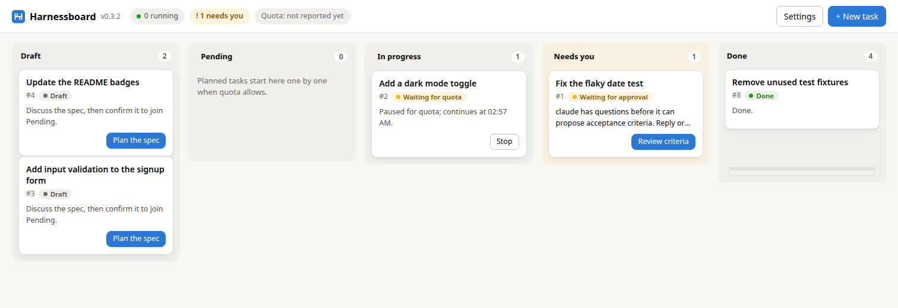
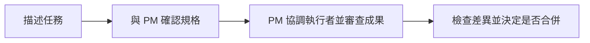

# Harnessboard

Harnessboard 在本機任務看板協調 AI 程式代理，讓你合併前審查工作成果。

  

[English](README.md) · **繁體中文**





- **一個 PM** 協調工作、權限與審查；獨立執行者可使用各自的分支。
- **本機看板** 顯示進度、問題、用量與結果，由你審查並決定是否合併。
- **代理程式：** Claude Code 與 Codex 可擔任 PM；Gemini 與 Docker 設定可執行任務。詳見[設定](docs/configuration.md)與 [PM 流程](docs/pm-workflow.md)。

## 快速開始

約三分鐘即可開始，下載依賴與建置時間另計。需要 **Git**、**Node.js 22.13 以上**、Corepack，以及已安裝並登入的代理程式 CLI，例如 [Claude Code](https://docs.claude.com/en/docs/claude-code)。

**1. 安裝並建置**（使用相容 Bash 的終端機）：

```bash
git clone https://github.com/AquilaWei/harnessboard.git
cd harnessboard
corepack enable
pnpm install --frozen-lockfile
pnpm build
alias hb="node $PWD/packages/server/dist/cli.js"
```

**2. 啟動看板**並保持執行：

```bash
hb serve &
```

開啟 [http://127.0.0.1:4317](http://127.0.0.1:4317)。以下指令繼續使用同一個終端機。

**3. 在練習用 Git repository 建立第一個任務**（Git 須先設定作者）：

```bash
mkdir hello && cd hello
git init -b main
echo "# Hello" > README.md
git add README.md && git commit -m "init"
hb add "Add a Usage section to README.md" --criteria "- README.md has a Usage section"
hb ls
```

在看板開啟任務，追蹤 PM 對話並核准規格。完成後用 `hb diff <id>` 檢查差異，再用 `hb merge <id>` 合併。詳見 [CLI 參考](docs/cli.md)與[工作流程](docs/workflow.md)。

## 延伸閱讀

- [設定、代理程式與權限](docs/configuration.md) · [PM 流程](docs/pm-workflow.md) · [網頁看板](docs/web-board.md)
- [桌面程式](docs/desktop-app.md) · [手機與 Android](docs/phone-access.md) · [Loop 模式](docs/loop-mode.md)
- [開發與測試](docs/development.md) · [參與貢獻](CONTRIBUTING.md) · [架構](docs/architecture.md) · [變更紀錄](CHANGELOG.md)

## 授權

[Apache-2.0](LICENSE)。Harnessboard 為獨立專案，與 Anthropic 無關。詳見[第三方授權](THIRD-PARTY-NOTICES.md)。
