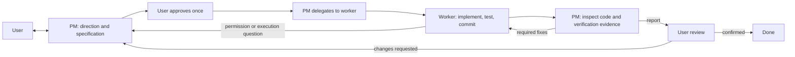

# PM-led tasks

New tasks use one PM conversation as the user-facing entry point. The PM agrees the
scope and acceptance criteria with you, then delegates implementation and verification,
judges permission requests, and reviews the architecture and functionality. Existing
tasks keep their fixed-role workflow.

PM tasks do not show the legacy Handoffs tab: delegation summaries and PM acceptance
carry the results forward. Inspect individual worker results under Details. Historical
role notes remain available on legacy tasks.



## Create and configure

Choose a PM profile/model and the worker model pool in **New task**. The PM currently
requires a local Claude Code or Codex profile. Workers can use any configured provider,
including Gemini and Docker profiles. No additional model API credentials are introduced.
Under **Available workers**, enable a profile, choose a model from its platform menu,
and click **Add model**. Repeat to allow multiple models; remove individual entries to
narrow the pool. The profile default is initially included. Custom model IDs remain
available when the platform does not list a model. These controls are also available
when editing a stopped task's PM configuration.
Only configured, explicitly permitted worker models can be dispatched.

## PM-appointed secretary

After specification approval, the PM directly dispatches workers and may use
`appoint_secretary` to select a permitted local Claude Code or Codex model. Dispatch
ensures an appointment even when the PM omits it. Automatic selection prefers permitted
model names containing haiku/mini/nano/small/flash, otherwise the first available local
profile/model; names do not guarantee price. Include a lightweight model in the permitted
pool, or let the PM explicitly select one. Appointment does not start a CLI.

During execution, all worker progress, questions, delivery and failures pass through the
secretary first. It summarizes routine progress and handles clearly authorized routine
permissions. For a simple question completely answered by approved instructions, it can
use `reply_worker` with a verbatim quote from the specification, assignment or applicable
rules. The harness validates the quote and the original pending worker identity before
resuming that worker. A repeat question after a secretary answer must go to the PM.

If uncertain for any reason, the secretary immediately uses `escalate_pm`. Technical
decisions, scope changes, failures and delivery review require escalation; it cannot finish
a batch while questions or deliveries remain unresolved. Escalation preserves the original
worker IDs, questions and evidence. The PM personally answers or directs the original
worker with `continue_work`; subsequent execution messages return to the secretary.
The secretary cannot dispatch, edit files, contact the user or accept delivery.

Each batch also includes the initial goal, scope and acceptance of only the workers
referenced by its permissions, progress or results, plus their recorded PM
`continue_work` instructions in chronological order. This includes permission-only
batches and historical worker session IDs. Explicit later PM instructions can revise
earlier task details; unclear conflicts still go to the PM. Routine work does not
require every filename or command to appear in the top-level specification.
These instructions survive restarts; old follow-ups that were never recorded are
not reconstructed. Worker reports cannot create new authorization.

The harness handles its own MCP tool confirmations directly. Higher-risk permissions are
deterministically escalated by the secretary router without an extra model call. User
messages still wake the PM directly and preempt an active secretary batch.

Each batch starts a fresh conversation with approved instructions and pending events,
without the PM/worker transcript. Concurrent events remain pending for a later batch.
Failure, 60-second timeout or quota exhaustion escalates once and suspends secretary
processing until PM reappointment. If no permitted local profile is available, a visible
notice records that the PM handles events directly. Restart preserves appointment and
cursor; expired permissions and worker questions cannot be answered again. Existing PM
tasks adopt the router when their workflow next starts; running processes need a restart.

The Team panel shows the secretary below the PM, with its model, status, batch history,
tokens and cost. Its usage is included in task totals and excluded from PM/worker totals;
permission history identifies decisions made by the secretary. Lightweight models still
use tokens: compare total task cost and PM run count when evaluating savings.

```bash
hb add "Add a dark mode toggle" --pm claude --pm-model sonnet \
  --worker claude:sonnet codex:gpt-5.5
hb approve 1
hb chat 1 "Please check keyboard navigation too."
hb stop 1
hb resume 1
```

The first specification always requires explicit approval, including supplied criteria.
Material scope changes use the same approval. Other uncertainties are questions answered
through Chat; answering a question does not approve a specification.

```bash
hb pm 1                             # inspect PM configuration
hb pm 1 --config '{"agentId":"claude","model":null,"effort":null,"workers":[{"agentId":"codex","models":[null]}]}'
```

Stop a task before changing its PM configuration. The Details panel shows PM and worker
usage, child results and acceptance findings. Standard task totals include every managed
PM and worker session exactly once; missing provider usage stays unknown.

## Delegation and permissions

PM and workers choose whether to delegate based on dependencies, elapsed time, context
and token cost. Small tasks need no extra agents; tightly coupled edits should stay with
one agent. There is no fixed two-worker limit. Local Claude Code and Codex workers can
use the same managed delegation tools as the PM; Gemini and Docker transports currently
remain leaf workers because they cannot reach this task-scoped MCP bridge. The `profiles`
tool reports delegation support. Native CLI subagents remain disabled.

Each delegated job records its parent. PM can inspect the whole tree; workers can manage
only their descendants, within their original scope and permitted profile/model pool.
Read-only workers cannot delegate write access or make PM permission/specification decisions.
Workers use `ask_pm` for missing information or authorization; the PM answers with
`continue_work` or asks the user through the existing Chat flow.

Dispatch returns immediately. For independent development, PMs and workers use
`workspace: "branch"` with explicit `writePaths`: repository-relative filenames or directory
prefixes ending in `/` (no globs). Each job must describe one bounded feature, its exclusions,
interface contracts and concrete acceptance tests. Sibling jobs cannot claim overlapping
paths; a branch child must stay within its parent's ownership. Assign shared API/schema
changes to one owner or complete that prerequisite before parallel implementation. Do not
edit a child's owned paths while it runs. Disjoint paths reduce Git conflicts but cannot
prove that interfaces or behavior are compatible: the parent still owns integration tests.

A branch job forks its parent's current clean committed HEAD into a private branch and
worktree and can write concurrently with other private workspaces. Dirty or busy sources
refuse branching. All transport execution, commit checks and delivery evidence use that
job's directory. Ownership violations fail delivery. `continue_work` preserves the branch,
worktree and model conversation. The Team panel shows branch, workspace, owned paths and
the last integrated commit.

Use `integrate_work` after a direct child delivers clean committed work. It merges into the
parent workspace (the task workspace for PM children), serializing integration into that
directory. Conflicts return paths and the target commit without changing target files or
index. Continue the same child to merge that target commit, resolve within its ownership,
commit and test, then retry integration. Inspect and test the combined result before
acceptance. Parents cannot deliver, and the PM cannot accept, unmerged completed branches.
Branch/worktree state survives cancellation and restart for explicit inspection and reuse;
it is retained with the delivery evidence rather than deleted automatically.

Omitting `workspace`, or selecting `"shared"`, preserves the shared-directory workflow for
coupled work and special build/install jobs. Shared writers queue per directory; a parent
using shared write children must call `wait` and end its turn before they can acquire the
directory. Independent read-only work can still run in parallel. Waiting is not completion
and does not require a final clean commit at a shared handoff boundary. `report_progress`
records meaningful milestones or blockers without model polling.

The PM retains all user-facing responsibilities: initial specification discussion and
approval, progress reports, necessary questions, scope changes, review and final acceptance.
Worker results return through their parent; the PM also receives compact status updates
for supervision. Cancelling a job cancels its descendants and retains files and evidence.
A parent cannot complete with unfinished children, and final acceptance checks the entire tree.

Explicit existing tool rules still apply. Other worker permission requests go to the PM,
which can allow the specific request once, deny it with a reason, or ask you when the
impact or authorization is unclear. It cannot add permanent global rules through its
permission tool. User decisions and PM decisions are separately attributed in history.
Platform and operating-system restrictions still apply. Gemini currently cannot pause for
interactive approvals, so refused operations must be resolved by an alternative worker
or a user decision; the harness never silently enables unrestricted mode.

Stopping a task stops its children and invalidates pending permissions. After a restart,
interrupted children are marked stopped and shown to the PM rather than dispatched again.
The PM must inspect existing work before explicitly continuing it. Old permission IDs are
not replayed. Historical failed/stopped work remains visible even without new child events.
`wait` rejects empty waits. If the PM ends without a next step, the harness gives one
corrective turn; continued inaction becomes an explicit coordination failure, not a fake
request for user approval.

## Context and acceptance

PM turns receive an authoritative compact work-tree snapshot on every turn, plus new
progress/escalations, user messages and changed specification/rule content. Content hashes track the specification, configured rule documents and worker
pool per PM conversation. Worker continuations similarly avoid resending unchanged job
instructions and rules. Compaction restores required context. Original documents and
full evidence remain available when correctness requires inspection; the harness cannot
prevent a model from rereading repository files of its own accord.

Workers report exact test commands and outcomes, changes and remaining risks. Full worker
replies are stored as evidence outside the repository, with bounded summaries sent to the
PM. The PM inspects the real diff, relevant code, functionality and verification evidence,
and delegates any necessary fixes or missing tests. Acceptance requires all children to
be completed or explicitly cancelled, no pending permissions, a completed implementation
job and a clean current HEAD. It records architecture, functionality and verification
findings against that commit.

PM acceptance submits a completion report and moves the task to **Review**. The report
shows the summary, architecture, functionality and verification findings. The user checks
the result and chooses **Mark done** (or merges the changes) to complete it. Worktree changes are merged only when you choose
**Merge** or run `hb merge`; PM acceptance does not authorize publication. A merge conflict
returns to the PM for worker fixes and another acceptance pass.

## Agent team on desktop and phone

Open **Agent team** in a PM task to see robot nodes for the PM, workers and their subagents.
Reporting lines, current activity and status update from managed events. Select a node
for its goal, scope, acceptance criteria, blocker/result, observed/result commit, configured
and reported models, token breakdown, estimated API cost, execution time and event log.
Usage on a node covers only that agent; children are counted separately. Missing usage is
unknown, not zero. Activity is a reported milestone or tool event, not inferred progress.

Desktop shows a collapsible tree beside the inspector, with zoom, pan and fit controls.
Phones show connected hierarchy cards with bounded indentation; selecting a robot opens
full-width details. Back preserves the tree's branch state and scroll position. Selection
survives rotation. Controls support touch and keyboard; status also has text labels.
Agent details are read-only: send instructions and opinions through the PM Chat.

## Legacy tasks and validation

Existing records migrate to `workflow: legacy` without changing their role assignments,
files or events. `hb add --legacy` and `hb loop` retain the old workflow. To convert an
idle legacy task, use Details or:

```bash
hb pm 1 --convert --config '{"agentId":"claude","model":null,"effort":null,"workers":[{"agentId":"claude","models":[null]}]}'
```

Stop active sessions and resolve pending permissions first. Conversion preserves history
and approved criteria; draft criteria are not automatically approved. Legacy Loop tasks
become PM tasks without replaying their feature-by-feature workflow.

Automated tests cover the tool transport, approval, dispatch, worker reuse, permissions,
cancellation, concurrency, restart and migration using scripted agents. Live Claude Code
and Codex model turns, managed nested delegation on live providers and desktop/phone interaction remain separate
acceptance checks. No local installer is built by this change.

To compare consumption, run identical tasks with the same models and criteria using
`hb add --legacy` and `hb add`, then compare `hb show` usage, cache reads/writes, run count,
elapsed time and correctness. Prompt-size regression tests demonstrate omitted repeated
context; they are not a measurement of real token savings. No saving percentage is assumed.

## Manual acceptance

Automated coverage uses managed scripted CLI processes and real desktop/mobile browser
viewports. It does not claim live-model quality, real-phone acceptance or an installed
Electron upgrade. Check these before release:

- With local Claude Code and Codex, approve a small task, delegate independent analysis,
  then delegate an edit from a worker. Expect one writer at a time, child results returned
  to the parent, and the PM to review the integrated current commit.
- On a real phone, open Agent team, expand a deep branch, inspect model/token details,
  return and rotate. Expect usable touch controls, retained selection/scroll and no page
  overflow; PM Chat and approval actions must remain reachable.
- In the desktop app, inspect a larger tree with zoom/pan/fit, switch agents and stop the
  task. Expect the whole subtree to stop and old results to remain inspectable.
- Restart an interrupted task explicitly. Expect the PM to see stopped workers and inspect
  existing files before continuing, without requesting unchanged specification approval.

PM tasks also accept existing folders without Git or commits. These tasks run in the selected folder; Harnessboard creates an empty local bookkeeping commit without staging files. After specification approval, PM arranges project setup, ignore rules and project commits according to the configured coding standards. Remote repository creation still requires explicit authorization.
