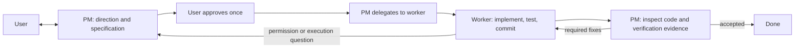

# PM-led tasks

New tasks use one PM conversation as the user-facing entry point. The PM agrees the
scope and acceptance criteria with you, then delegates implementation and verification,
judges permission requests, and reviews the architecture and functionality. Existing
tasks keep their fixed-role workflow.

PM tasks do not show the legacy Handoffs tab: delegation summaries and PM acceptance
carry the results forward. Inspect individual worker results under Details. Historical
role notes remain available on legacy tasks.



## Create and configure

Choose a PM profile/model and the worker model pool in **New task**. The PM currently
requires a local Claude Code or Codex profile. Workers can use any configured provider,
including Gemini and Docker profiles. No additional model API credentials are introduced.
Under **Available workers**, enable a profile, choose a model from its platform menu,
and click **Add model**. Repeat to allow multiple models; remove individual entries to
narrow the pool. The profile default is initially included. Custom model IDs remain
available when the platform does not list a model. These controls are also available
when editing a stopped task's PM configuration.
Only configured, explicitly permitted worker models can be dispatched.

```bash
hb add "Add a dark mode toggle" --pm claude --pm-model sonnet \
  --worker claude:sonnet codex:gpt-5.5
hb approve 1
hb chat 1 "Please check keyboard navigation too."
hb stop 1
hb resume 1
```

The first specification always requires explicit approval, including supplied criteria.
Material scope changes use the same approval. Other uncertainties are questions answered
through Chat; answering a question does not approve a specification.

```bash
hb pm 1                             # inspect PM configuration
hb pm 1 --config '{"agentId":"claude","model":null,"effort":null,"workers":[{"agentId":"codex","models":[null]}]}'
```

Stop a task before changing its PM configuration. The Details panel shows PM and worker
usage, child results and acceptance findings. Standard task totals include every managed
PM and worker session exactly once; missing provider usage stays unknown.

## Delegation and permissions

The PM normally continues the same worker conversation for implementation and fixes.
At most two workers run per task, and only one may write the task worktree. The second
worker is for independent read-only analysis. Workers cannot access the PM's tools.
Native subagents are disabled until their permissions, cancellation and usage can satisfy
the same management contract; same-platform and cross-platform jobs both use managed CLI
sessions today.

Dispatch returns a job ID immediately. A waiting PM ends its model turn and is woken by
child results, permissions or user messages, without polling. The PM can continue a
worker, cancel it, change to another permitted worker, or ask you about an unresolved
problem. Cancelled work remains in the history, including any files it changed; the final
writer and PM must account for those changes before acceptance.

Explicit existing tool rules still apply. Other worker permission requests go to the PM,
which can allow the specific request once, deny it with a reason, or ask you when the
impact or authorization is unclear. It cannot add permanent global rules through its
permission tool. User decisions and PM decisions are separately attributed in history.
Platform and operating-system restrictions still apply. Gemini currently cannot pause for
interactive approvals, so refused operations must be resolved by an alternative worker
or a user decision; the harness never silently enables unrestricted mode.

Stopping a task stops its children and invalidates pending permissions. After a restart,
interrupted children are marked stopped and shown to the PM rather than dispatched again.
The PM must inspect existing work before explicitly continuing it. Old permission IDs are
not replayed.

## Context and acceptance

PM turns receive only new child summaries, user messages and changed specification/rule
content. Content hashes track the specification, configured rule documents and worker
pool per PM conversation. Worker continuations similarly avoid resending unchanged job
instructions and rules. Compaction restores required context. Original documents and
full evidence remain available when correctness requires inspection; the harness cannot
prevent a model from rereading repository files of its own accord.

Workers report exact test commands and outcomes, changes and remaining risks. Full worker
replies are stored as evidence outside the repository, with bounded summaries sent to the
PM. The PM inspects the real diff, relevant code, functionality and verification evidence,
and delegates any necessary fixes or missing tests. Acceptance requires all children to
be completed or explicitly cancelled, no pending permissions, a completed implementation
job and a clean current HEAD. It records architecture, functionality and verification
findings against that commit.

An accepted task becomes **Done**. Worktree changes are merged only when you choose
**Merge** or run `hb merge`; PM acceptance does not authorize publication. A merge conflict
returns to the PM for worker fixes and another acceptance pass.

## Legacy tasks and validation

Existing records migrate to `workflow: legacy` without changing their role assignments,
files or events. `hb add --legacy` and `hb loop` retain the old workflow. To convert an
idle legacy task, use Details or:

```bash
hb pm 1 --convert --config '{"agentId":"claude","model":null,"effort":null,"workers":[{"agentId":"claude","models":[null]}]}'
```

Stop active sessions and resolve pending permissions first. Conversion preserves history
and approved criteria; draft criteria are not automatically approved. Legacy Loop tasks
become PM tasks without replaying their feature-by-feature workflow.

Automated tests cover the tool transport, approval, dispatch, worker reuse, permissions,
cancellation, concurrency, restart and migration using scripted agents. Live Claude Code
and Codex model turns, platform-native subagents and desktop launch remain separate
acceptance checks. No local installer is built by this change.

To compare consumption, run identical tasks with the same models and criteria using
`hb add --legacy` and `hb add`, then compare `hb show` usage, cache reads/writes, run count,
elapsed time and correctness. Prompt-size regression tests demonstrate omitted repeated
context; they are not a measurement of real token savings. No saving percentage is assumed.
